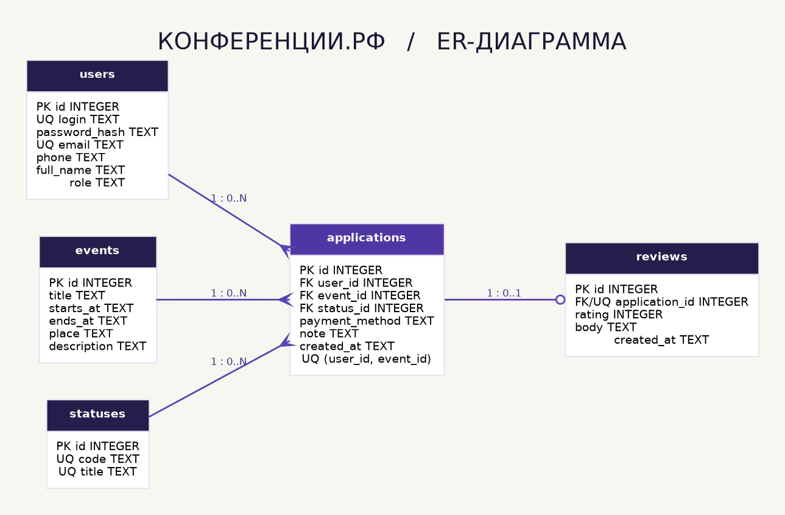

# Практическая работа 2. Проектирование базы данных

Модель хранит пользователей, конференции, заявки, справочник статусов и отзывы. Гость не представлен строкой в таблице пользователей. Роль зарегистрированного пользователя хранится в поле `users.role`.

| Таблица | Назначение и ключи |
|---|---|
| `users` | Первичный ключ `id`, уникальные `login` и `email`. Пароль хранится как хеш в `password_hash`. |
| `events` | Первичный ключ `id`, название, начало и окончание, место и описание. Время хранится строкой ISO 8601 в UTC. |
| `statuses` | Первичный ключ `id`, уникальный машинный код и подпись статуса. Начальный статус — «Новая». |
| `applications` | Внешние ключи на пользователя, мероприятие и статус. Уникальная пара `(user_id, event_id)` предотвращает повторную заявку. |
| `reviews` | Уникальный внешний ключ `application_id`. На одну заявку допускается не более одного отзыва. Оценка от 1 до 5. |

Один пользователь может подать много заявок, на одно мероприятие может поступить много заявок. Таким образом, заявки образуют связь многие-ко-многим между пользователями и мероприятиями. Один статус используется многими заявками. У заявки может быть ноль или один отзыв.

Ограничения ключей, диапазона оценки и уникальности проверяет база. Право создать отзыв после окончания мероприятия и допустимость перехода между статусами проверяет серверная логика проекта.

[SQL-схема SQLite](schema.sql) · [ER-диаграмма SVG](er-diagram.svg)

