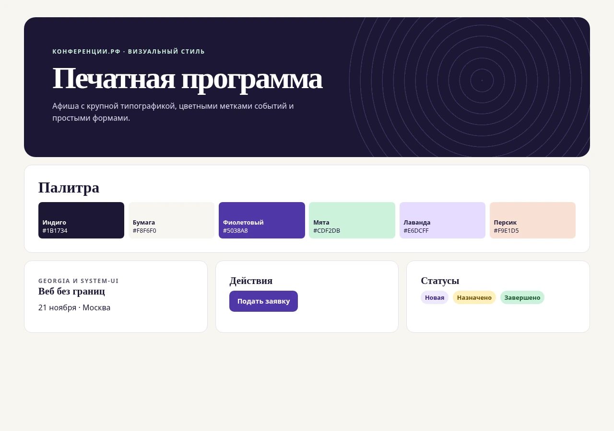

# Практическая работа 7. Дизайн-концепция портала

Концепция «Печатная программа» основана на трёх визуальных мотивах. Крупные заголовки напоминают афишу, цветные поля помогают узнавать направления событий, концентрические линии отсылают к пересечению идей и людей. Эти мотивы собраны в [мудборде](moodboard.html).

| Элемент | Решение | Применение |
|---|---|---|
| Тёмный индиго | `#1B1734` | Основной текст и обложка афиши |
| Тёплый фон | `#F8F6F0` | Рабочая область и контраст с белыми карточками |
| Фиолетовый | `#5038A8` | Основные действия, ссылки и активный раздел |
| Мятный | `#CDF2DB` | Действие на тёмном фоне, завершённые состояния |
| Лавандовый | `#E6DCFF` | Цветовая метка карточки веб-конференции |
| Персиковый | `#F9E1D5` | Цветовая метка карточки события о дизайне |
| Georgia и system-ui | Засечки для заголовков, нейтральный шрифт для интерфейса | Афиша, подписи, формы и служебные сообщения |

## Компоновка

В каталоге обложка и карточки формируют визуальную иерархию. В формах основное действие находится после полей, подсказка вынесена в соседнюю колонку. В списках заявки читаются по названию и дате, справа показаны статус и доступное действие. На телефоне колонки перестраиваются в последовательный список.

Макеты используют одну шапку, скругления и цветовые переменные. Для основных действий применяется один цвет, а статус всегда содержит текст. Это соответствует требованиям к стилю из [работы № 6](../06-design-requirements/design-requirements.md).

## Макеты

[Афиша](catalog.webp) · [Вход](login.webp) · [Регистрация](register.webp) · [Мои заявки](applications.webp) · [Новая заявка](apply.webp) · [Админ-панель](admin.webp) · [Личный кабинет](profile.webp)

