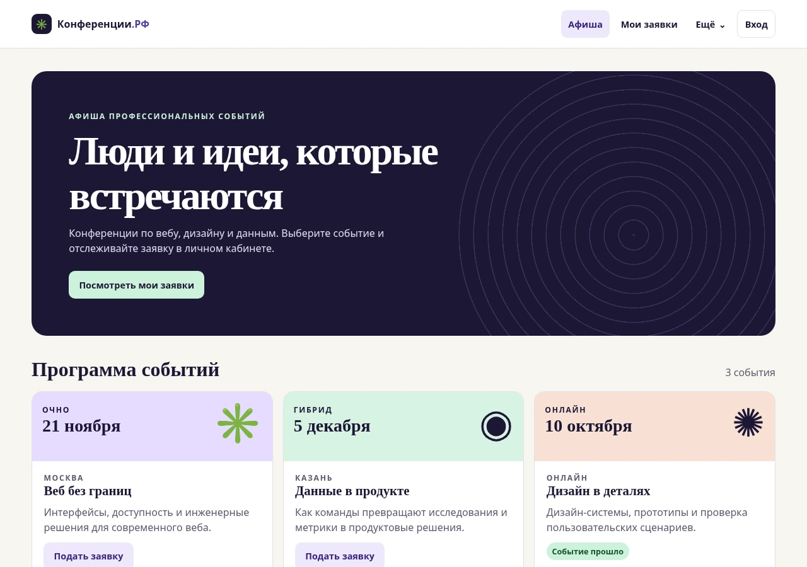

# Практическая работа 10. Разработка интерфейса пользователя

Свёрстан [интерфейс портала](index.html) на HTML, CSS и JavaScript. В нём есть афиша, вход, регистрация, личный кабинет, список заявок, форма подачи заявки, панель администратора и форма отзыва. Все экраны связаны навигацией, их можно открывать напрямую по якорям.

Учебная версия работает с демонстрационными данными в браузере. Заявки, статусы и отзывы хранятся локально. Регистрация создаёт временный профиль без сохранения пароля. Серверная авторизация, оплата и подключение базы в эту практику не входят.

## Проверка

| Проверка | Результат |
|---|---|
| Chromium 156, 1280 × 900 | Все восемь экранов отображаются без горизонтальной прокрутки. Карточки афиши стоят в три колонки. |
| Chromium 156, 390 × 844 | Все восемь экранов отображаются без горизонтальной прокрутки. Карточки и формы перестраиваются в одну колонку. |
| Firefox ESR 153, 390 × 844 | Проверена отрисовка всех восьми экранов, включая формы и панель администратора. |
| Сценарии в Chromium | Проверены вход с верными и неверными данными, регистрация, подстановка события, новая заявка, запрет дубликата, два фильтра, два перехода статуса, сохранение отзыва и блокировка повторного отзыва. |

[Chromium, 390 × 844](mobile.webp) · [Firefox, 390 × 844](firefox-mobile.webp)
