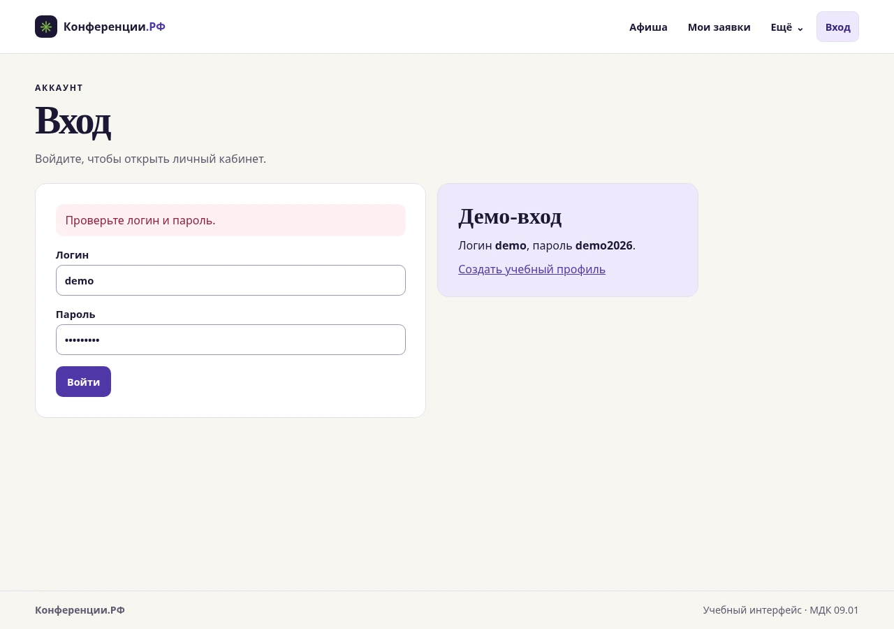

# Практическая работа 14. Анимация и микроанимации

[Демонстрация](index.html) использует интерфейс работы № 10 и подключает [отдельный CSS-файл](motion.css).

| Элемент | Действие | Длительность |
|---|---|---|
| Экран | При переходе по меню содержимое проявляется и смещается на 7 px | 220 мс |
| Кнопка | При нажатии кратко уменьшается до 97% | 140 мс |
| Поле формы | При получении фокуса меняется цвет рамки | 150 мс |
| Карточка события | При наведении поднимается на 4 px на устройствах с указателем | 180 мс |
| Сообщение формы | Подтверждение или ошибка появляются плавно | 160 мс |

При включённом `prefers-reduced-motion: reduce` переходы отключены. Анимации экрана и карточки используют `transform` и `opacity`, поэтому во время движения соседние элементы сохраняют положение. Обработчики формы и навигации выполняют действие сразу.

## Проверка

В Chromium 156 проверены переход в «Мои заявки» по анимированной кнопке, подъём карточки, состояние нажатия кнопки, цвет рамки поля, появление ошибки и отключение анимаций в режиме уменьшенного движения. На одном локальном переходе 14 измеренных интервалов `requestAnimationFrame` составили 16,5–16,8 мс. Это результат одного прогона в тестовом окружении.

